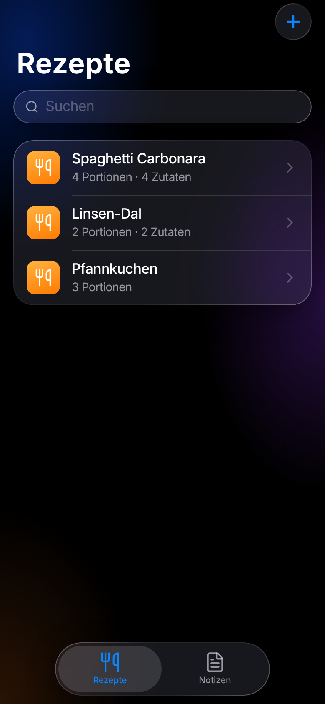
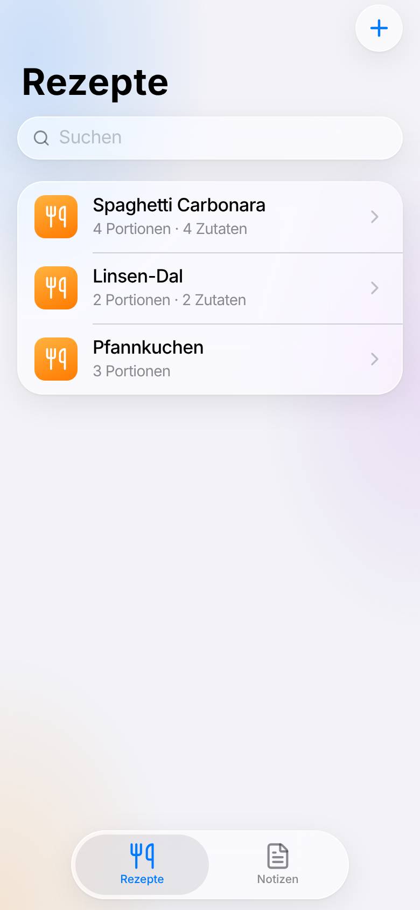
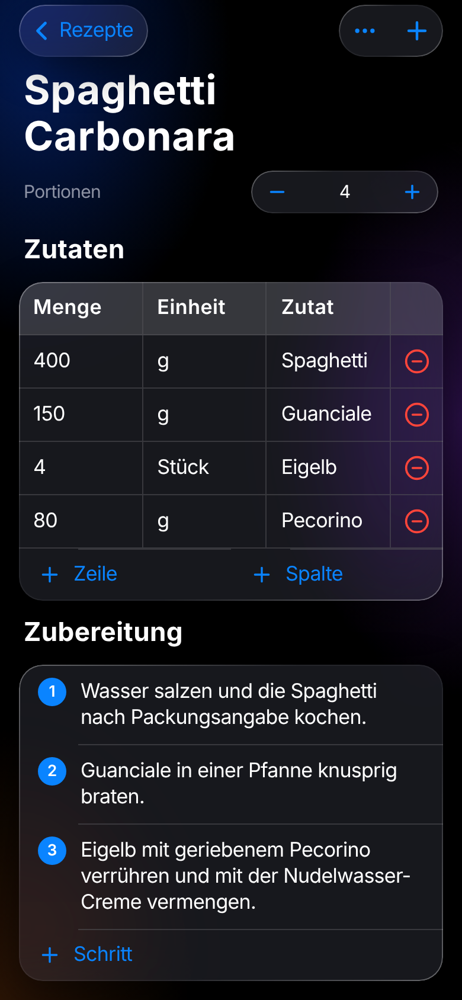
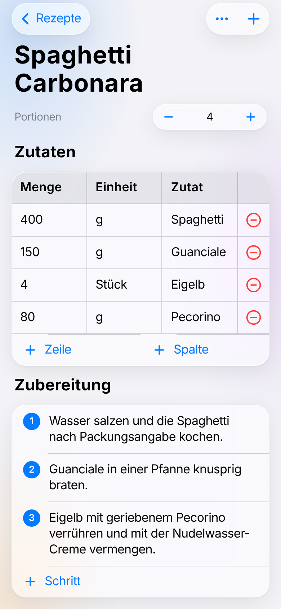

# Notiz-App

Notiz- und Rezepte-App als installierbare Web-App (PWA) im iOS-Stil mit Liquid-Glass-Optik.
Läuft auf Android und iPhone ohne App-Store, ohne Browser-Leiste.
Konzept, Entscheidungen und Bauplan: [docs/KONZEPT.md](docs/KONZEPT.md)

| Dunkel | Hell |
|---|---|
|  |  |
|  |  |

## Stand

- [x] Datenmodell mit Blöcken (Text, Überschrift, Checkliste, Tabelle, Schritte, Bild)
- [x] Markdown-Format für Drive-Dateien (Lesen und Schreiben, getestet)
- [x] iOS-Oberfläche: große Titel, Glas-Karten, schwebende Tab-Leiste, Kontextmenü, Wisch-zum-Löschen, Wisch-zurück, Hell/Dunkel
- [x] Rezepte und Notizen, Suche, Editor mit Tabellen, Checklisten und Schritt-für-Schritt
- [x] Installierbar (Manifest, Vollbild) und offline nutzbar (Service Worker)
- [x] Live-Sync (Firestore) mit Offline-Betrieb, Einladungslink statt Login, „wer ist gerade wo“ – getestet gegen den Firestore-Emulator; Einrichtung: [docs/FIREBASE-EINRICHTUNG.md](docs/FIREBASE-EINRICHTUNG.md)
- [ ] Google-Drive-Backup und Import von außen
- [ ] Bilder einfügen

## Entwickeln

```bash
npm install
npm run dev      # Entwicklungsserver, auch im WLAN erreichbar
npm test         # Tests (Markdown, Einkaufsliste, Sync mit Speicher-Server)
# Sync gegen den Firestore-Emulator testen (Java nötig):
#   npx firebase emulators:start --only firestore --project demo-notiz
#   NOTIZ_EMULATOR=127.0.0.1:8180 npm test
npm run build    # Ausgabe: dist/
```
